## You've built a DES model!

{height=400px}

Now it's time to share results of the model.

## Let's share the model

:::: {.columns}

::: {.column width="50%"}


:::

::: {.column width="50%"}


You could send everyone your Python code.<br/>
But they might not...

* Know Python.
* Have it installed.
* Have the right environment or packages.
* Know which bits to run or which numbers to change.
* Have time to figure all that out.

:::

::::

## Actually, let's send a report

:::: {.columns}

::: {.column width="50%"}

Run a few scenarios.

Make some lovely charts.

Send everyone a report.

Job done. Surely.

:::

::: {.column width="50%"}


:::

::::

## You get a few questions back...

:::: {.columns}

::: {.column width="50%"}

"Can you rerun it with another three beds?"

"What if we have fewer staff on Tuesdays?"

"Can we change the arrival rate?"

"Can you try all three of those things together?"

<br>

Somewhere, a file called `final_report_v7_ACTUAL_FINAL.pdf` is being created.

<br>

But what if they could try it themselves?

:::

::: {.column width="50%"}


:::

::::

##

{height=500px}

## Enter Streamlit

Streamlit lets us build a data-focused web application in Python.

We can give our DES model an interface so people can:

* Choose model inputs
* Run scenarios
* Explore charts and results


## DES app showcase: acute medical unit {.showcase}

<https://amumodelling-hsma.streamlit.app/>

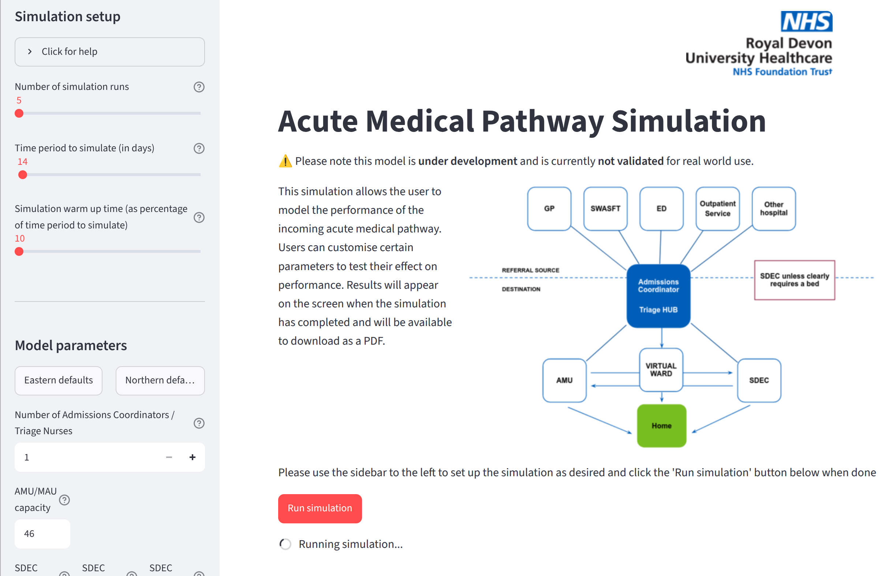{height=570px}

## DES app showcase: acute medical unit {.showcase}

<https://amumodelling-hsma.streamlit.app/>

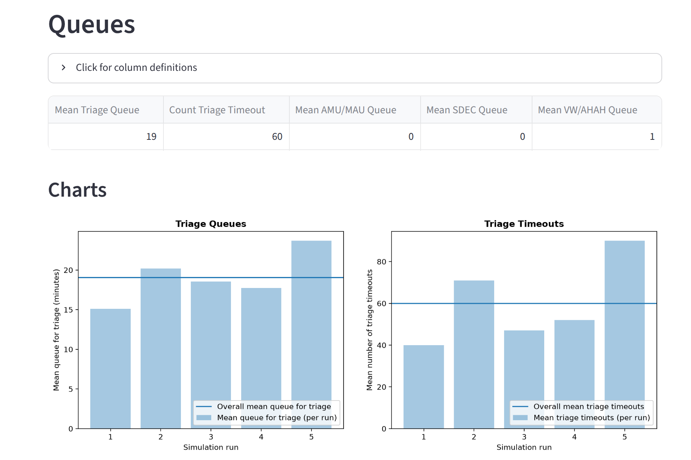{height=570px}

## DES app showcase: elective surgery{.showcase visibility="hidden"}

TODO: Not currently working

<https://gstt-hands-waitlist.streamlit.app/>

## DES app showcase: stroke ward {.showcase}

<https://stroke-model-des.streamlit.app/>

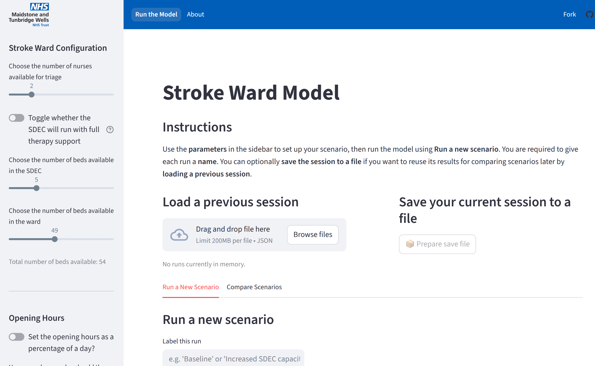{height=570px}

## DES app showcase: stroke ward {.showcase}

<https://stroke-model-des.streamlit.app/>

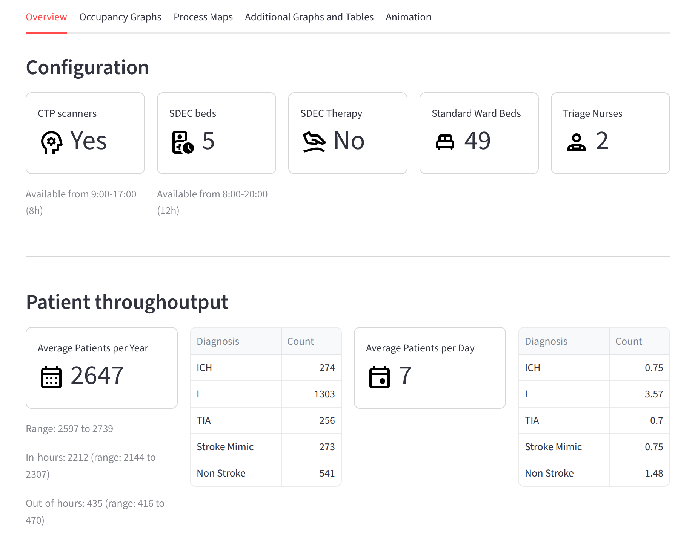{height=570px}

## DES app showcase: stroke ward {.showcase}

<https://stroke-model-des.streamlit.app/>

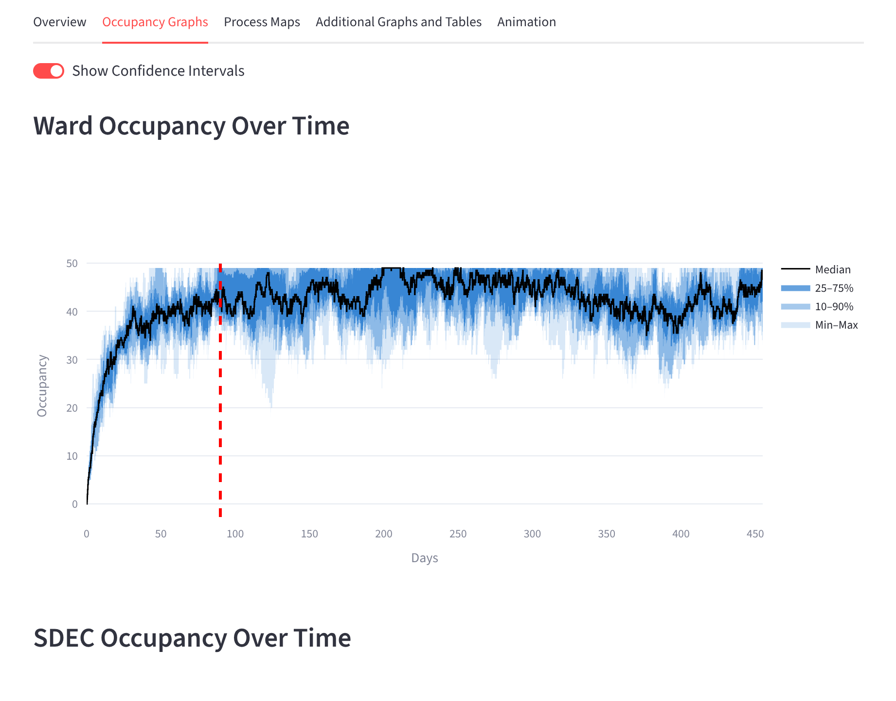{height=570px}

## DES app showcase: non-elective flow {.showcase}

<https://non-elective-flow-simulation-model-club.streamlit.app/>

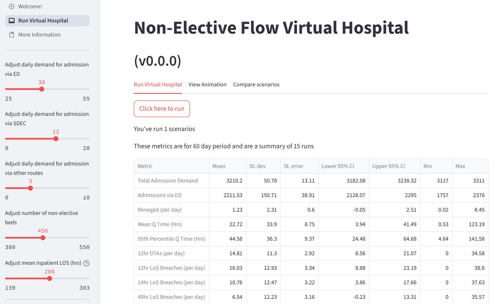{height=570px}

## DES app showcase: non-elective flow {.showcase}

<https://non-elective-flow-simulation-model-club.streamlit.app/>

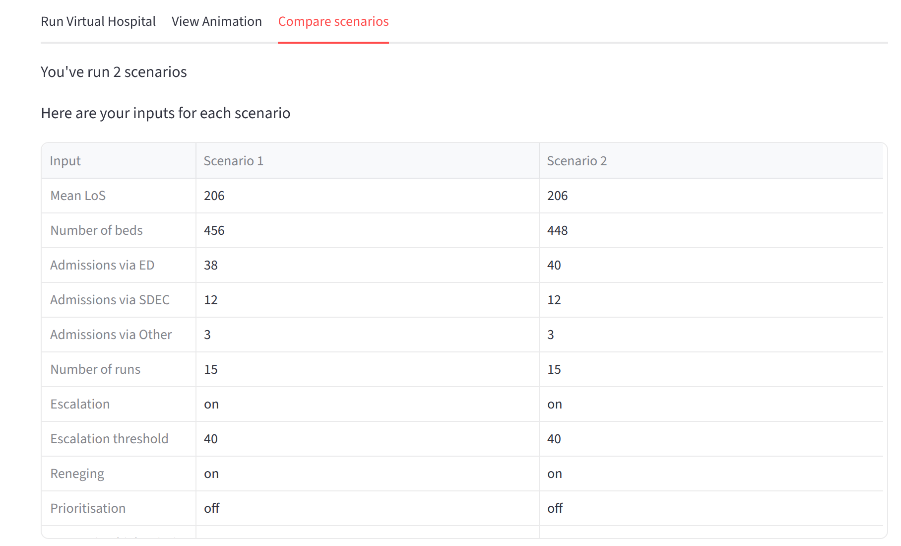{height=570px}

## DES app showcase: urgent treatment centre {.showcase}

<https://stars-simpy-example.streamlit.app/>

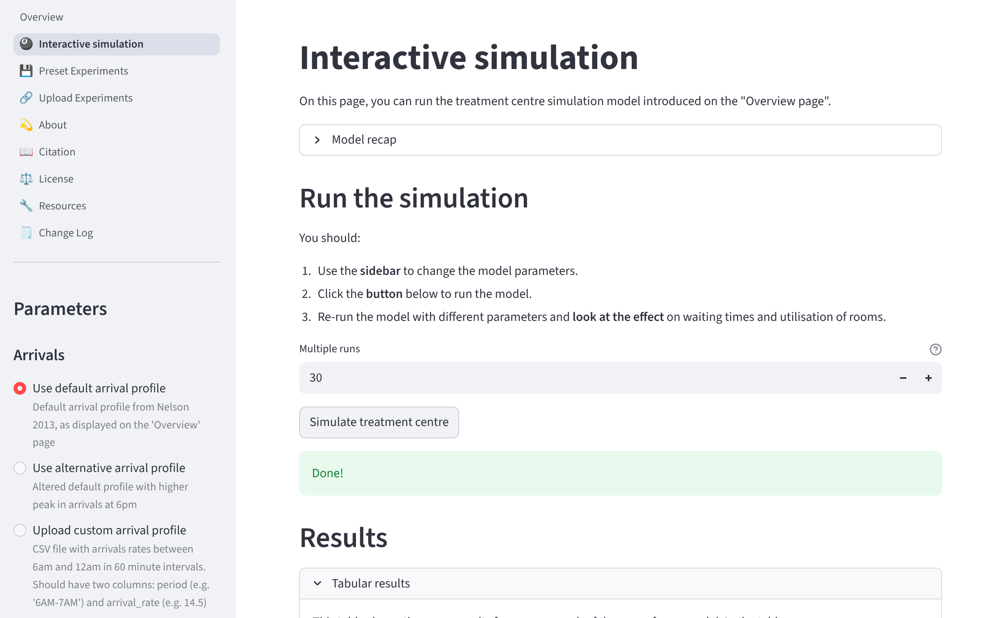{height=570px}

## DES app showcase: urgent treatment centre {.showcase}

<https://stars-simpy-example.streamlit.app/>

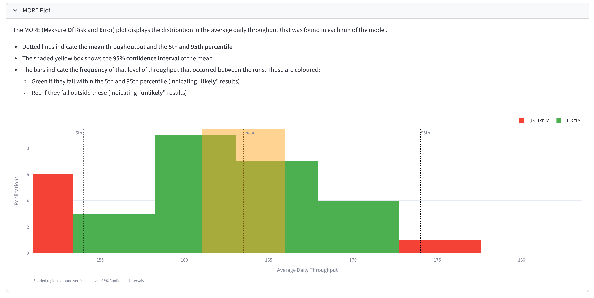{height=570px}

## DES app showcase: DES playground {.showcase}

<https://playground.hsma.co.uk/>

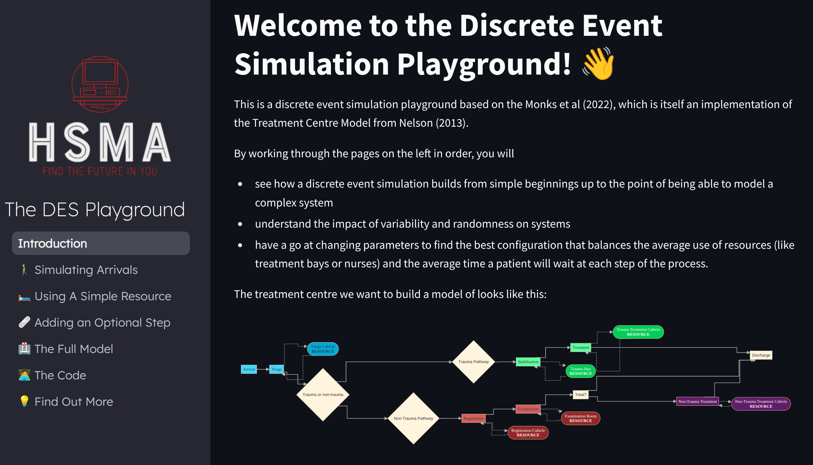{height=570px}

## DES app showcase: vidigi examples {.showcase visibility="hidden"}

TODO

<https://simpy-visualisation.streamlit.app/>

## Let's build a streamlit app!

We'll use the DES model from session 2C. As a reminder:

* It has `Param`, `Patient`, `Model`, and `Trial` classes.
* It simulates a simple nurse clinic.

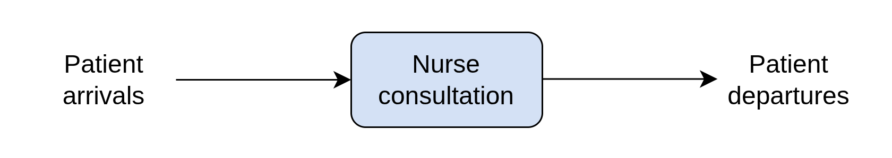

## Before we build the app...

Remove the `print()` statements from the end of the file.

```{.python code-overflow="scroll"}
# REMOVE ALL OF THIS...

base_case_params = Param()
base_case_trial = Trial(base_case_params)
base_case_trial.run_trial()
base_case_trial.calculate_trial_results()
print ("BASE CASE TRIAL RESULTS")
print ("-----------------------")
print ("Queuing Time for the Nurse")
print (f"Mean : {base_case_trial.trial_mean_q_time_nurse:.2f} minutes")
print (f"SD : {base_case_trial.trial_sd_q_time_nurse:.2f} minutes")
print (f"90th Perc : {base_case_trial.trial_perc_90_q_time_nurse:.2f} minutes")
print (f"Standard Error : {base_case_trial.se_q_time_nurse:.2f}")
print (
    f"95% CI : ({base_case_trial.ci_lower_q_time_nurse:.2f}, ",
    f"{base_case_trial.ci_upper_q_time_nurse:.2f}) minutes"
)
print ()

what_if_params = Param(num_nurses=2)
what_if_trial = Trial(what_if_params)
what_if_trial.run_trial()
what_if_trial.calculate_trial_results()
print ("2 NURSES TRIAL RESULTS")
print ("----------------------")
print ("Queuing Time for the Nurse")
print (f"Mean : {what_if_trial.trial_mean_q_time_nurse:.2f} minutes")
print (f"SD : {what_if_trial.trial_sd_q_time_nurse:.2f} minutes")
print (f"90th Perc : {what_if_trial.trial_perc_90_q_time_nurse:.2f} minutes")
print (f"Standard Error : {what_if_trial.se_q_time_nurse:.2f}")
print (
    f"95% CI : ({what_if_trial.ci_lower_q_time_nurse:.2f}, ",
    f"{what_if_trial.ci_upper_q_time_nurse:.2f}) minutes"
)
print ()
```

## Before we build the app...

Add a calculation for the cost of nurse time.

```{.python code-line-numbers="10,18"}
class Param:
    def __init__(
        self,
        mean_patient_inter=5,
        mean_nurse_consult_time=6,
        sd_nurse_consult_time=1,
        num_nurses=1,
        sim_duration=120,
        num_replications=5,
        nurse_cost_per_hour=30,
    ):
        self.mean_patient_inter = mean_patient_inter
        self.mean_nurse_consult_time = mean_nurse_consult_time
        self.sd_nurse_consult_time = sd_nurse_consult_time
        self.num_nurses = num_nurses
        self.sim_duration = sim_duration
        self.num_replications = num_replications
        self.nurse_cost_per_hour = nurse_cost_per_hour
```

## Before we build the app...

Add a calculation for the cost of nurse time.

```{.python}

        self.ci_lower_q_time_nurse = self.trial_mean_q_time_nurse - (
            t * self.se_q_time_nurse
        )

        self.ci_upper_q_time_nurse = self.trial_mean_q_time_nurse + (
            t * self.se_q_time_nurse
        )

        # NEW
        self.total_nurse_cost = (
            self.param.num_nurses
            * self.param.sim_duration
            / 60
            * self.param.nurse_cost_per_hour
        )
```

## Our updated model

```{.python code-overflow="scroll"}
# Insert the complete updated model here.
```